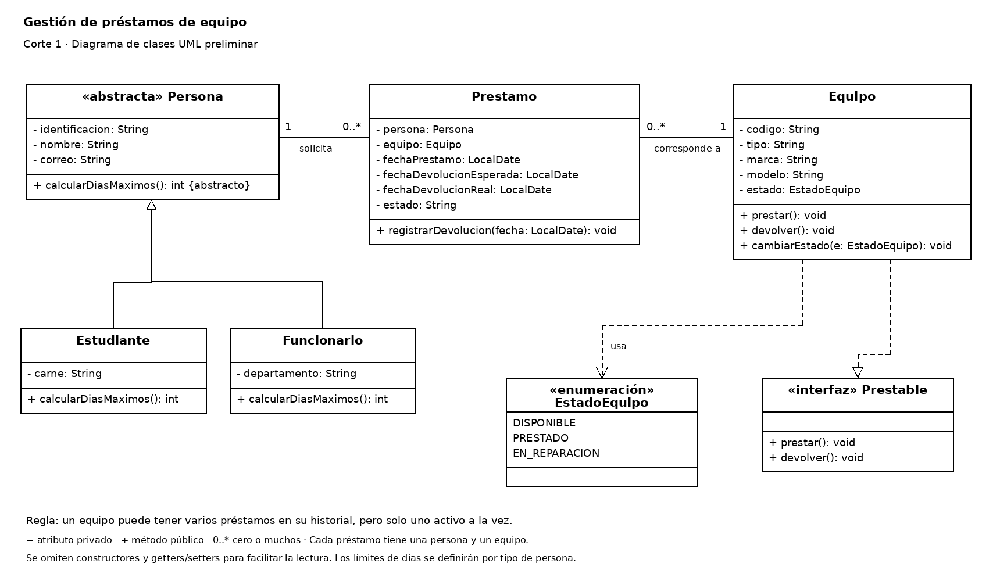

# Corte 1 — Análisis, diseño y estructura inicial

> Complete todas las secciones. Elimine las indicaciones entre `< >` al terminar.

## 8.1 Identificación

```text
Caso seleccionado:Caso 1
Integrante 1:Owen Lopez Dinarte
Integrante 2:
URL del repositorio:[Owen-Lopez-Dinarte-2/Examen-Progra2](https://github.com/Owen-Lopez-Dinarte-2/Examen-Progra2/tree/main)
```

## 8.2 Descripción del problema

**Problema que se desea resolver:**

Una Institución ocupa de un sistema que lleve el control de prestamos de equipos, como lo son las computadoras, proyectores y cámaras. este sistema permite conocer cuales están disponibles para usar y que personas los están usando además de cuando tienen que devolverlo

**Quién utilizaría el sistema:**

La persona encargada de los préstamos de equipos de la institución.

**Principales operaciones:**

- Registrar personas y equipos.
- Consultar cuáles equipos están disponibles.
- Consultar quién tiene cada equipo y cuándo debe devolverlo.

**Justificación de la elección del caso:**

Es un caso sencillo y permite aplicar lo que hemos visto en el curso

## 8.3 Requerimientos funcionales

```text
RF-01.El sistema permitirá registrar estudiantes y funcionarios.
RF-02.El sistema permitirá registrar equipos, como computadoras, proyectores y cámaras.
RF-03.El sistema permitirá buscar personas por su identificación y equipos por su código.
RF-04.El sistema permitirá consultar cuáles equipos están disponibles.
RF-05.El sistema permitirá registrar préstamos con la persona, el equipo y las fechas de préstamo y devolución esperada.
RF-06.El sistema permitirá consultar los préstamos activos y quién tiene cada equipo.
RF-07.El sistema permitirá registrar devoluciones y dejar el equipo disponible nuevamente.
RF-08.El sistema permitirá marcar un equipo disponible como en reparación y volverlo a disponible cuando esté reparado
```

## 8.4 Identificación de clases

| Clase       | Responsabilidad                                      | Atributos principales                                                                |
| ----------- | ---------------------------------------------------- | ------------------------------------------------------------------------------------ |
| Persona     | Guardar los datos de las Personas                    | Identificación, Nombre, Correo                                                       |
| Estudiante  | Representa a los estudiantes de la institucion       | Carné                                                                                |
| Funcionario | Representa a los funcionarios de la Institucion      | Departamento                                                                         |
| Equipo      | Guarda la informacion del equipo ademas de su Estado | código, tipo, marca, modelo, estado                                                  |
| Prestamo    | Llevar el control de los prestamos                   | persona, equipo, fechaPréstamo, fechaDevoluciónEsperada, fechaDevoluciónReal, estado |


## 8.5 Relaciones entre clases

|Clases relacionadas|Tipo|Multiplicidad|Explicación|
|---|---|---|---|
|Estudiante y Persona|Herencia|No aplica|Un estudiante es una persona y hereda sus datos.|
|Funcionario y Persona|Herencia|No aplica|Un funcionario es una persona y hereda sus datos.|
|Persona y Prestamo|Asociación|1 a 0..*|Una persona puede tener varios préstamos, pero cada préstamo pertenece a una sola persona.|
|Equipo y Prestamo|Asociación|1 a 0..*|Un equipo puede aparecer en varios préstamos a lo largo del tiempo, pero cada préstamo corresponde a un solo equipo.|

## 8.6 Herencia o abstracción

```text
Persona
├── Estudiante
└── Funcionario
```

**Justificación:**

Estudiante y Funcionario heredan de Persona porque comparten atributos comunes, pero cada uno posee atributos y comportamientos específicos que justifican su definición en clases separadas.

## 8.7 Interface

```java
public interface Prestable {
void prestar();
void devolver();
}
```

**Clases que la implementarán y por qué:**

La clase Equipo implementará la interfaz Prestable porque los equipos pueden prestarse y devolverse. Estos métodos permitirán cambiar su estado y validar que la operación se pueda realizar

## 8.8 Enumeración

```java
public enum EstadoEquipo {
    DISPONIBLE,
    PRESTADO,
    EN_REPARACION
    
}
```

**Uso dentro del sistema:**

Se utilizará en la clase Equipo para indicar si está disponible, prestado o en reparación. Solo se podrán prestar los equipos que estén disponibles.

## 8.9 UML preliminar

Archivo: `docs/corte_1/uml.png` o `docs/corte_1/uml.pdf`



## Código del Corte 1

Clases creadas en `proyecto/src/main/java/cr/ac/proyecto/model`:

- Persona(Abstracta)
- Estudiante
- Funcionario
- Equipo
- Prestamo
- EstadoEquipo(Enum)
- Prestable(Interface)
## Distribución del trabajo

| Integrante | Aportes principales |
| ---------- | ------------------- |
| Owen Lopez | Todo                |
